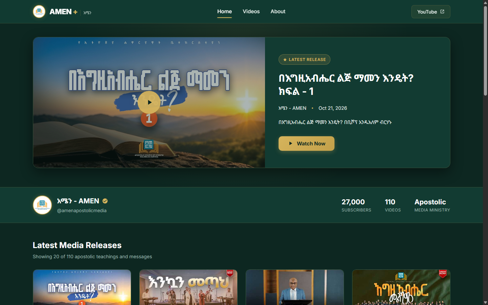
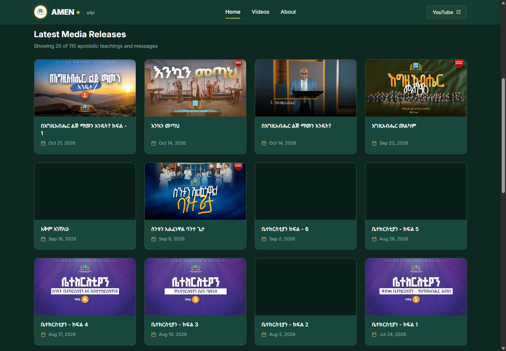
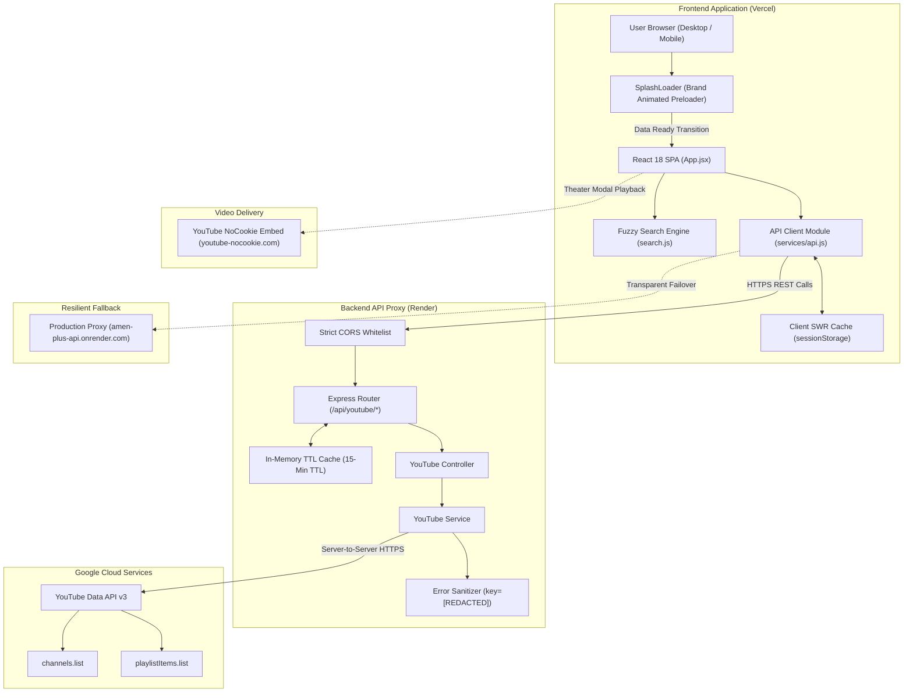

<div align="center">

  

  # AMEN+ (አሜን+)
  ### A Fast, Sacred, Privacy-Enhanced Christian Media Streaming Platform

  [](https://react.dev/)
  [](https://vite.dev/)
  [](https://nodejs.org/)
  [](https://expressjs.com/)
  [](https://developers.google.com/youtube/v3)
  [](LICENSE)

  **[Live Application](https://amen-plus.vercel.app/)** • **[Production API Service](https://amen-plus-api.onrender.com/api/health)** • **[Documentation Index](docs/README.md)** • **[Official YouTube Channel](https://www.youtube.com/@amenapostolicmedia)** • **[Telegram](https://t.me/AmenApostolicMedia)**

</div>

---

## 📑 Table of Contents

- [Project Overview](#-project-overview)
- [Key Features](#-key-features)
- [Documentation Suite](#-documentation-suite)
- [Screenshots Gallery](#-screenshots-gallery)
- [Technology Stack](#-technology-stack)
- [System Architecture](#-system-architecture)
- [Approximate Fuzzy Search Engine](#-approximate-fuzzy-search-engine)
- [Full-Stack Caching & Performance](#-full-stack-caching--performance)
- [API Overview](#-api-overview)
- [Repository Structure](#-repository-structure)
- [Environment Configuration](#-environment-configuration)
- [Local Installation & Setup](#-local-installation--setup)
- [Security & Privacy Principles](#-security--privacy-principles)
- [Testing & Quality Assurance](#-testing--quality-assurance)
- [Roadmap & Future Enhancements](#-roadmap--future-enhancements)
- [Author & Acknowledgments](#-author--acknowledgments)

---

## 📖 Project Overview

**AMEN+** is a dedicated Christian media streaming platform created for **አሜን - AMEN** (`@amenapostolicmedia`), the official media ministry of the **Apostolic Church of Ethiopia**. 

The ministry produces sermons, apostolic teachings, conference broadcasts, and gospel songs in Amharic. While YouTube serves as the primary video storage infrastructure, streaming directly on commercial platforms exposes congregation members and seekers to intrusive commercial advertisements, distracting algorithmic recommendations, and user tracking.

AMEN+ solves this problem by delivering a curated, ad-free, theater-style streaming experience directly connected to the channel's media catalogue. Operating through a secure backend proxy built with Node.js and Express, AMEN+ communicates with the **YouTube Data API v3** to sync videos, channel metadata, and uploads dynamically while strictly isolating API credentials on the server.

---

## ✨ Key Features

- **⚡ High-Speed Performance Engine**:
  - Sub-second Time to First Byte (TTFB) powered by multi-tier caching.
  - Client-side SWR (Stale-While-Revalidate) cache stored in `sessionStorage` with 15-minute TTL.
  - Express in-memory server cache with automatic garbage collection sweeps.
  - HTTP `Cache-Control` headers for browser and edge intermediary caching.

- **✨ Sacred Emerald & Gold Brand-Animated Splash Preloader**:
  - Immersive loading animation featuring the ministry's brand logo, rotating dashed gold orbit rings, and light sweep shimmer.
  - Zero Flash of Unstyled Content (FOUC) via direct CSS pre-linking in the HTML shell.
  - Gated strictly upon verified data arrival (`isDataReady = Boolean(channel && videos && videos.length > 0)`).
  - Smooth 500ms opacity transition into the main interface.

- **🔍 Intelligent Approximate Fuzzy Video Search**:
  - Client-side search engine with **Amharic phonetic normalization** (`ሀ/ሐ/ኀ`, `ሰ/ሠ`, `አ/ዐ`, `ጸ/ፀ`).
  - First-order and fourth-order vowel harmonization (`አ` ↔ `ኣ`, `ሀ` ↔ `ሃ`).
  - Typo-tolerant matching using dynamic **Levenshtein Distance** algorithms.
  - Sub-millisecond instantaneous filtering with live result counters and empty-state recovery.

- **🌍 Bilingual Internationalization (i18n)**:
  - Instantaneous one-click toggle between **Amharic (አማርኛ)** and **English**.
  - Persistent language preference saved in `localStorage`.
  - Harmonized typography combining `Noto Sans Ethiopic` and `Inter`.

- **📱 Comprehensive Multi-Device Responsiveness**:
  - Fluid adaptive layouts covering Mobile (375px / 390px), Tablet (768px / 900px), Laptop (1024px), and Desktop (1440px+).
  - Verified `0px` horizontal overflow across all viewports.

- **🎬 Privacy-Enhanced Theater Video Player**:
  - Streams via YouTube's official privacy-enhanced domain (`youtube-nocookie.com`).
  - Accessible modal dialog featuring programmatic focus trapping, `Escape` key dismissal, and focus restoration to the triggering card.

- **🔄 Dual-Layer Resilient API Fallback**:
  - Transparent failover mechanism: if local backend services encounter missing credentials or network issues, requests automatically route to the production backup proxy without disrupting the user.

- **🛡️ Enterprise-Grade Security Architecture**:
  - Zero client-side API key exposure.
  - Exact-origin CORS whitelisting.
  - Regex-based error message sanitization stripping all key parameters.

---

## 📚 Documentation Suite

Comprehensive technical guides are available in the [`docs/`](docs/) directory:

| Guide | Link | Overview |
| :--- | :--- | :--- |
| **System Architecture** | [docs/ARCHITECTURE.md](docs/ARCHITECTURE.md) | High-level data flow, multi-cloud topology, SWR cache, and security boundaries. |
| **Fuzzy Search Engine** | [docs/SEARCH_ENGINE.md](docs/SEARCH_ENGINE.md) | Amharic phonetic normalization matrix, Levenshtein distance formulas, and benchmarks. |
| **REST API Reference** | [docs/API.md](docs/API.md) | Endpoint specifications, query parameters, JSON schemas, and HTTP status codes. |
| **Bilingual Localization** | [docs/LOCALIZATION.md](docs/LOCALIZATION.md) | i18n architecture, translation dictionaries, language toggle, and Ethiopic typography. |
| **Deployment Guide** | [docs/DEPLOYMENT.md](docs/DEPLOYMENT.md) | Production setup instructions for Vercel (Frontend) and Render (Backend API). |
| **Portfolio & Case Study** | [docs/PORTFOLIO.md](docs/PORTFOLIO.md) | Engineering challenges, resume bullet points, and recruiter summary. |

---

## 📸 Screenshots Gallery

### Desktop Experience

| Homepage & Hero Spotlight | Video Browsing & Search Bar |
| :---: | :---: |
|  |  |

| Theater Video Player Modal | Ministry About & Community |
| :---: | :---: |
|  |  |

### Mobile Experience

| Mobile Stream & Responsive Layout | Slide-Down Navigation Menu |
| :---: | :---: |
|  |  |

---

## 🛠️ Technology Stack

| Layer | Technology | Purpose |
| :--- | :--- | :--- |
| **Frontend Framework** | React 18.3.1 | Modular component architecture, custom hooks, and state management |
| **Build Tool** | Vite 6.2.0 | Ultra-fast Hot Module Replacement (HMR) and optimized rollup bundling |
| **Styling** | Vanilla CSS3 (Design Tokens) | Deep Emerald (`#123B32`, `#0D2721`) and Champagne Gold (`#D6B45C`) palette |
| **Typography** | Google Fonts | `Noto Sans Ethiopic` (Ge'ez script) and `Inter` (UI elements) |
| **Backend Runtime** | Node.js (>=18.0.0) | High-concurrency event-driven JavaScript runtime |
| **Backend Framework** | Express 4.21.2 | RESTful routing, in-memory caching middleware, and parameter validation |
| **Security & CORS** | `cors` 2.8.5, `dotenv` 16.4.7 | Exact-origin whitelisting, environment configuration isolation |
| **External API** | YouTube Data API v3 | Google Cloud REST service for channel statistics and upload playlists |
| **Video Playback** | YouTube IFrame (No-Cookie) | `youtube-nocookie.com` privacy-enhanced video playback |
| **Frontend Hosting** | Vercel | Global edge CDN hosting with automated GitHub CI/CD |
| **Backend Hosting** | Render | Managed cloud web service hosting for Express proxy |

---

## 🏛️ System Architecture



For comprehensive architectural design decisions, see [docs/ARCHITECTURE.md](docs/ARCHITECTURE.md).

---

## 🔍 Approximate Fuzzy Search Engine

AMEN+ includes a purpose-built search engine (`client/src/utils/search.js`) optimized for both English and Amharic text:

1. **Phonetic Equivalence Matrix**: Normalizes interchangeable Amharic Fidel variants into canonical forms:
   - Gutturals: `ሐ`, `ኀ`, `ሃ`, `ኃ` $\rightarrow$ `ሀ`
   - Sibilants: `ሠ`, `ሣ` $\rightarrow$ `ሰ`
   - Glottals: `ዐ`, `ዓ`, `ኣ` $\rightarrow$ `አ`
   - Ejectives: `ፀ`, `ፃ` $\rightarrow$ `ጸ`
2. **Levenshtein Distance Matching**: Dynamic edit distance calculation permits minor spelling mistakes (1 edit for words $\ge 4$ letters; 2 edits for words $\ge 7$ letters).
3. **Multi-Token Query Parsing**: Queries like `"የኢትዮጵያ ሐዋርያዊት"` or `"apostolic teaching"` tokenize each word and match across both title and description fields simultaneously.

For complete algorithmic specifications, see [docs/SEARCH_ENGINE.md](docs/SEARCH_ENGINE.md).

---

## ⚡ Full-Stack Caching & Performance

To preserve YouTube API quota and achieve sub-second page loads:

- **Client SWR Cache**: Fast `sessionStorage` caching serving repeat page visits in `< 5ms`.
- **Server Heap Cache**: In-memory `Map` with 15-minute expiration and 30-minute background garbage collection.
- **Cache Headers**: Emits `Cache-Control: public, max-age=900, stale-while-revalidate=1800`.
- **Diagnostic Headers**: Returns `X-Cache: HIT` or `X-Cache: MISS` for transparent cache observability.

---

## 📡 API Overview

All backend endpoints are served under `/api`:

| Method | Endpoint | Query Parameters | Description |
| :--- | :--- | :--- | :--- |
| `GET` | `/api/health` | None | Server heartbeat and uptime status |
| `GET` | `/api/youtube/channel` | None | Verified channel metadata, subscriber count, total views, and uploads ID |
| `GET` | `/api/youtube/videos` | `maxResults` (1–50, default: 20)<br>`pageToken` (optional string) | Uploaded videos list with thumbnails, publication dates, and pagination tokens |

For request/response schemas and status codes, see [docs/API.md](docs/API.md).

---

## 📁 Repository Structure

```
amen-plus/
├── client/                               # Frontend Single Page Application
│   ├── public/
│   │   ├── favicon.svg                   # Browser tab icon
│   │   ├── icons.svg                     # SVG sprite for UI icons
│   │   ├── logo.png                      # Official 800×800 brand logo
│   │   ├── og-banner.png                 # 1200×630 Open Graph sharing banner
│   │   ├── robots.txt                    # Search crawler directives
│   │   └── sitemap.xml                   # XML sitemap for SEO discovery
│   ├── src/
│   │   ├── assets/                       # Visual assets
│   │   ├── components/                   # Modular React UI components
│   │   │   ├── AboutSection.jsx          # Ministry background, Telegram link & details
│   │   │   ├── ChannelBar.jsx            # Live subscriber counts & verified badge
│   │   │   ├── Footer.jsx                # Copyright, ministry note & navigation links
│   │   │   ├── Header.jsx                # Navigation bar & language switcher
│   │   │   ├── Hero.jsx                  # Featured release spotlight
│   │   │   ├── SplashLoader.jsx          # Brand-animated preloader component
│   │   │   ├── VideoCard.jsx             # 16:9 thumbnail, metadata & keyboard actions
│   │   │   └── VideoModal.jsx            # YouTube NoCookie iframe modal with focus trap
│   │   ├── context/
│   │   │   └── LanguageContext.jsx       # Bilingual context provider & hook
│   │   ├── locales/
│   │   │   └── translations.js           # Amharic & English dictionary strings
│   │   ├── services/
│   │   │   └── api.js                    # Fetch client with SWR caching & dual fallback
│   │   ├── utils/
│   │   │   └── search.js                 # Amharic phonetic normalization & fuzzy matching
│   │   ├── App.css                       # Layout helper styles
│   │   ├── App.jsx                       # Root application component & state machine
│   │   ├── index.css                     # Emerald & Champagne Gold design tokens
│   │   └── main.jsx                      # React 18 DOM entry point
│   ├── index.html                        # HTML shell & social metadata
│   └── vite.config.js                    # Vite bundler configuration
│
├── server/                               # Backend API Proxy
│   ├── src/
│   │   ├── config/
│   │   │   └── youtube.js                # Environment configuration loader
│   │   ├── controllers/
│   │   │   └── youtubeController.js      # In-memory caching, validation & responses
│   │   ├── routes/
│   │   │   └── youtubeRoutes.js          # REST routes definition
│   │   ├── services/
│   │   │   └── youtubeService.js         # Upstream fetch logic & error sanitization
│   │   └── app.js                        # Express initialization, CORS & health route
│   ├── .env.example                      # Environment variables template
│   └── package.json                      # Dependencies & startup scripts
│
├── docs/                                 # Detailed Technical Documentation
│   ├── ARCHITECTURE.md                   # Full-stack architectural specification
│   ├── SEARCH_ENGINE.md                  # Phonetic normalization & fuzzy search guide
│   ├── API.md                            # REST API endpoints & schema reference
│   ├── LOCALIZATION.md                   # Bilingual i18n & Ethiopic typography
│   ├── DEPLOYMENT.md                     # Production deployment guide (Vercel & Render)
│   ├── PORTFOLIO.md                      # Engineering portfolio & resume bullet points
│   ├── README.md                         # Documentation index
│   └── screenshots/                      # High-resolution application screenshots
│
└── README.md                             # Root project documentation
```

---

## 🔐 Environment Configuration

Create a `.env` file inside `server/` modeled after `server/.env.example`:

```ini
# Server Listening Port (automatically assigned by Render in production)
PORT=5000

# Allowed Frontend Origins (supports comma-separated origins)
CLIENT_URL=http://localhost:5173,https://amen-plus.vercel.app

# Google Cloud YouTube Data API v3 Key
YOUTUBE_API_KEY=your_google_cloud_youtube_api_key_here

# Channel & Uploads Playlist Identifiers
YOUTUBE_CHANNEL_ID=UCGWqiRHa7VqmPfIiCJcW4lw
YOUTUBE_UPLOADS_PLAYLIST_ID=UUGWqiRHa7VqmPfIiCJcW4lw
```

The frontend uses Vite environment variables (optional for local development, defaults to relative or production proxy fallback):

```ini
# client/.env (Optional)
VITE_API_BASE_URL=https://amen-plus-api.onrender.com/api
```

> [!IMPORTANT]
> Never commit `.env` files containing real API credentials to version control. The repository's `.gitignore` automatically prevents `.env` from being tracked.

---

## 💻 Local Installation & Setup

### Prerequisites
- **Node.js** `v18.0.0` or higher
- **npm** `v9.0.0` or higher
- **Google Cloud YouTube Data API v3 Key** ([Google Cloud Console](https://console.cloud.google.com/apis/credentials))

### 1. Clone the Repository
```bash
git clone https://github.com/petersisay/AMEN-.git
cd amen-plus
```

### 2. Configure and Run Backend
```bash
cd server
npm install
cp .env.example .env
# Edit .env and supply your credentials
npm start
# Backend listening on http://localhost:5000
```

Verify backend health:
```bash
curl http://localhost:5000/api/health
# {"status":"ok","message":"AMEN+ backend is running"}
```

### 3. Configure and Run Frontend
In a separate terminal window:
```bash
cd client
npm install
npm run dev
# Vite dev server running at http://localhost:5173
```

Open your browser and navigate to `http://localhost:5173`.

---

## 🔒 Security & Privacy Principles

- **Server Credential Isolation**: Google Cloud API keys are strictly confined to the server environment and never bundled into frontend JavaScript.
- **Exact-Origin CORS**: Express verifies incoming `Origin` headers against configured allowed domains.
- **Regex Error Sanitization**: If Google Cloud returns errors containing URL parameters, `key=[^&\s]+` is automatically masked to `key=[REDACTED]`.
- **Privacy-Enhanced Video Embeds**: Playback uses `youtube-nocookie.com`, preventing advertising cookies unless playback is started.
- **Secure External Links**: All outbound links declare `target="_blank"` and `rel="noopener noreferrer"` to defend against tab-nabbing vulnerabilities.

---

## 🧪 Testing & Quality Assurance

- **Multi-Device Responsiveness**: Verified `0px` horizontal overflow across Mobile (375px/390px), Tablet (768px), Laptop (1024px), and Desktop (1440px+).
- **Search Engine Accuracy**: Validated phonetic equivalence for `ሀ/ሐ/ኀ`, `ሰ/ሠ`, `አ/ዐ`, and `ጸ/ፀ` across 110+ video titles.
- **Focus Trapping & Accessibility**: Tested `tabIndex` order, `Escape` key dialog dismissal, initial focus placement, and Tab focus containment inside `VideoModal`.
- **Zero FOUC Verification**: Confirmed immediate brand styling and no unstyled layout shifts during preloading.

---

## 🔮 Roadmap & Future Enhancements

1. **Category & Topic Filtering**: Add client-side category filter pills (e.g., *Teachings*, *Sermons*, *Worship*, *Conferences*).
2. **Bookmarks & Watch Later**: Local storage persistence for saving personal favorite teachings.
3. **PWA (Progressive Web App)**: Service worker caching and installability for offline metadata browsing.
4. **Audio-Only Streaming Mode**: Bandwidth-saving audio stream option for users with limited cellular data.

---

## 👤 Author & Acknowledgments

- **Lead Engineer**: **Petros Sisay** — [GitHub](https://github.com/petersisay) • [LinkedIn](https://linkedin.com/in/petersisay)
- **Ministry Partner**: [አሜን - AMEN (Apostolic Church of Ethiopia)](https://www.youtube.com/@amenapostolicmedia)
- **Telegram Channel**: [@AmenApostolicMedia](https://t.me/AmenApostolicMedia)
- **License**: This project is open-source under the [MIT License](LICENSE).
