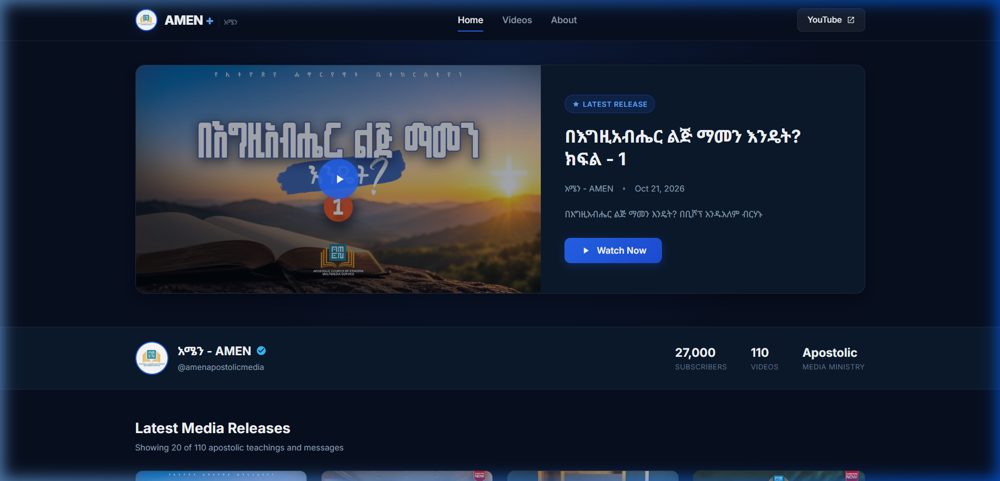
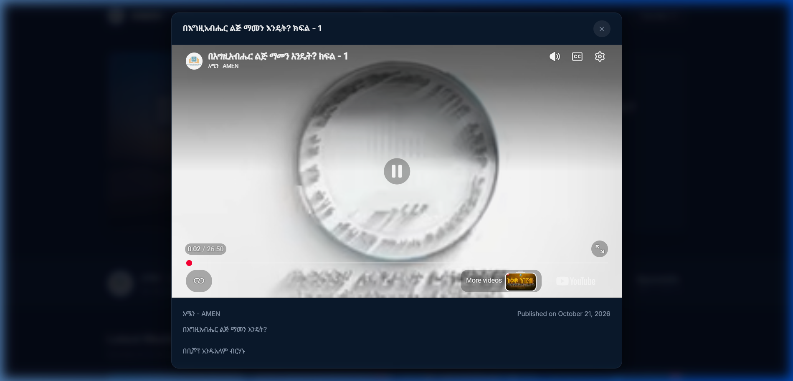

<div align="center">

  

  # AMEN+ (አሜን+)
  **A YouTube-Powered Streaming Platform for አሜን (AMEN) Media Ministry**

  [](https://react.dev/)
  [](https://vite.dev/)
  [](https://nodejs.org/)
  [](https://expressjs.com/)
  [](https://developers.google.com/youtube/v3)
  [](LICENSE)

  [Features](#-key-features) • [Screenshots](#-screenshots) • [Architecture](#-architecture) • [Getting Started](#-getting-started) • [Deployment](#-deployment) • [Security](#-security-by-design)

</div>

---

## 📖 Overview

**AMEN+** is a dedicated Christian media streaming platform built for **አሜን - AMEN** (@amenapostolicmedia), an official media ministry of the **Apostolic Church of Ethiopia**. 

The platform connects to the **YouTube Data API v3** through a secure Express backend proxy, serving the channel's catalogue of sermons, apostolic teachings, and worship videos in a modern streaming experience without exposing API credentials to the browser.

---

## 📸 Screenshots

### Homepage & Hero Release


### In-App Video Playback Modal


---

## ✨ Key Features

- **🔴 Live YouTube Data Synchronization**: Fetches real-time channel metadata, verified status, subscriber count (27K+), and the complete 110-video uploads catalogue.
- **🎬 Hero Featured Release**: Automatically spotlights the channel's latest video release with quick-action playback and high-resolution thumbnails.
- **⚡ Progressive Pagination**: Loads 20 videos initially, appending 10 additional videos on each "Load More" click until reaching the end of the catalogue.
- **📺 Embedded YouTube Modal Player**: Clean, theater-style video playback powered by YouTube's official privacy-enhanced embed (`youtube-nocookie.com`). Supports keyboard navigation (`ESC` to close), backdrop clicks, and dedicated controls.
- **🎨 Premium Streaming Interface**: Built with a dark navy palette (`#070F20`), tailored blue accents (`#2563EB`), smooth card elevations, and Ethiopian script typography (`Noto Sans Ethiopic`).
- **📱 Fully Responsive Design**: Fluid layouts across desktop, tablet, and mobile screens with an accessible slide-down mobile navigation drawer.
- **🛡️ Security by Design**: YouTube API credentials remain exclusively server-side. Includes exact-origin CORS whitelisting and automated error sanitization.

---

## 🏛️ Architecture & Project Structure

```
amen-plus/
├── client/                     # Frontend Application (React 18 + Vite)
│   ├── public/
│   │   └── logo.png            # Official AMEN circular logo asset
│   ├── src/
│   │   ├── components/         # Modular UI components
│   │   │   ├── Header.jsx      # Navigation bar & brand logo
│   │   │   ├── Hero.jsx        # Featured latest release spotlight
│   │   │   ├── ChannelBar.jsx  # Live subscriber count & verified badge
│   │   │   ├── VideoCard.jsx   # 16:9 responsive video card
│   │   │   ├── VideoModal.jsx  # YouTube iframe theater player
│   │   │   ├── AboutSection.jsx# Ministry description & subscribe callout
│   │   │   └── Footer.jsx      # Branding, legal & social links
│   │   ├── services/
│   │   │   └── api.js          # Client API proxy client
│   │   ├── App.jsx             # Root layout & pagination state
│   │   └── index.css           # Vanilla CSS design tokens & animations
│   ├── index.html              # HTML shell & font definitions
│   └── vite.config.js          # Vite build configuration
│
├── server/                     # Backend API (Node.js + Express)
│   ├── src/
│   │   ├── config/
│   │   │   └── youtube.js      # Environment & API configuration
│   │   ├── controllers/
│   │   │   └── youtubeController.js # Request validation & error handling
│   │   ├── routes/
│   │   │   └── youtubeRoutes.js# REST endpoints (/channel, /videos)
│   │   ├── services/
│   │   │   └── youtubeService.js# YouTube Data API v3 native fetch service
│   │   └── app.js              # Express app, CORS whitelist & entry point
│   ├── .env.example            # Environment variables template
│   └── package.json            # Node.js dependencies & scripts
│
└── docs/
    └── screenshots/            # Documentation previews
```

---

## 🚀 Getting Started

### Prerequisites

- **Node.js** `v18.0.0` or higher
- **npm** `v9.0.0` or higher
- **Google Cloud YouTube Data API v3 Key** ([Get an API Key](https://console.cloud.google.com/apis/credentials))

### 1. Clone the Repository

```bash
git clone https://github.com/petersisay/AMEN-.git
cd amen-plus
```

### 2. Configure the Backend

Navigate to the `server/` directory and configure environment variables:

```bash
cd server
npm install
cp .env.example .env
```

Open `server/.env` and supply your credentials:

```ini
PORT=5000
CLIENT_URL=http://localhost:5173
YOUTUBE_API_KEY=your_actual_youtube_api_key_here
YOUTUBE_CHANNEL_ID=UCGWqiRHa7VqmPfIiCJcW4lw
YOUTUBE_UPLOADS_PLAYLIST_ID=UUGWqiRHa7VqmPfIiCJcW4lw
```

Start the backend development server:

```bash
npm start
# AMEN+ backend running on port 5000
```

Verify backend health:
```bash
curl http://localhost:5000/api/health
# {"status":"ok","message":"AMEN+ backend is running"}
```

### 3. Configure and Start the Frontend

Open a new terminal and navigate to `client/`:

```bash
cd client
npm install
npm run dev
```

Visit **`http://localhost:5173`** in your browser.

---

## 📡 API Endpoints

All backend endpoints are prefixed under `/api`:

| Method | Endpoint | Query Parameters | Description |
| :--- | :--- | :--- | :--- |
| `GET` | `/api/health` | None | Service heartbeat & health check |
| `GET` | `/api/youtube/channel` | None | Returns metadata, statistics, and uploads ID for **አሜን - AMEN** |
| `GET` | `/api/youtube/videos` | `maxResults` (1-50, default 20)<br>`pageToken` (optional) | Returns uploaded videos with thumbnails, titles, dates, and pagination tokens |

---

## 🔒 Security by Design

- **Credential Isolation**: `YOUTUBE_API_KEY` is loaded exclusively inside `server/` via `dotenv` and is strictly excluded by `.gitignore`.
- **Zero Frontend Leakage**: The browser communicates only with `/api/youtube/*`. Google API keys never appear in client bundles, network requests, or responses.
- **Strict CORS Enforcement**: `server/src/app.js` permits only exact origins declared in `CLIENT_URL` (supporting comma-separated origins for production and local development). Arbitrary wildcards (`*`) are disallowed.
- **Error Sanitization**: Error messages strip and redact `key=[REDACTED]` before sending responses to prevent accidental token exposure during API exceptions.

---

## 🌐 Production Deployment

### Backend (Render)
1. Create a new **Web Service** on [Render](https://render.com) pointing to this repository.
2. Set **Root Directory** to `server`.
3. Set **Build Command** to `npm install`.
4. Set **Start Command** to `npm start`.
5. Add the following **Environment Variables** in Render:
   - `PORT`: Automatically set by Render.
   - `CLIENT_URL`: `https://your-frontend.vercel.app,http://localhost:5173`
   - `YOUTUBE_API_KEY`: Your Google Cloud YouTube Data API key.
   - `YOUTUBE_CHANNEL_ID`: `UCGWqiRHa7VqmPfIiCJcW4lw`
   - `YOUTUBE_UPLOADS_PLAYLIST_ID`: `UUGWqiRHa7VqmPfIiCJcW4lw`
6. Set the **Health Check Path** to `/api/health`.

### Frontend (Vercel)
1. Import the repository on [Vercel](https://vercel.com).
2. Set **Root Directory** to `client`.
3. Set **Framework Preset** to `Vite`.
4. Add the **Environment Variable**:
   - `VITE_API_BASE_URL`: `https://your-render-service.onrender.com/api`
5. Deploy.

---

## 📜 Acknowledgements & Ministry

- **Ministry**: [አሜን - AMEN (Apostolic Church of Ethiopia)](https://www.youtube.com/@amenapostolicmedia)
- **Telegram**: [@AmenApostolicMedia](https://t.me/AmenApostolicMedia)
- **Platform**: Developed with ❤️ for Christian media distribution.

---

## 📄 License

This project is open-source under the [MIT License](LICENSE).
