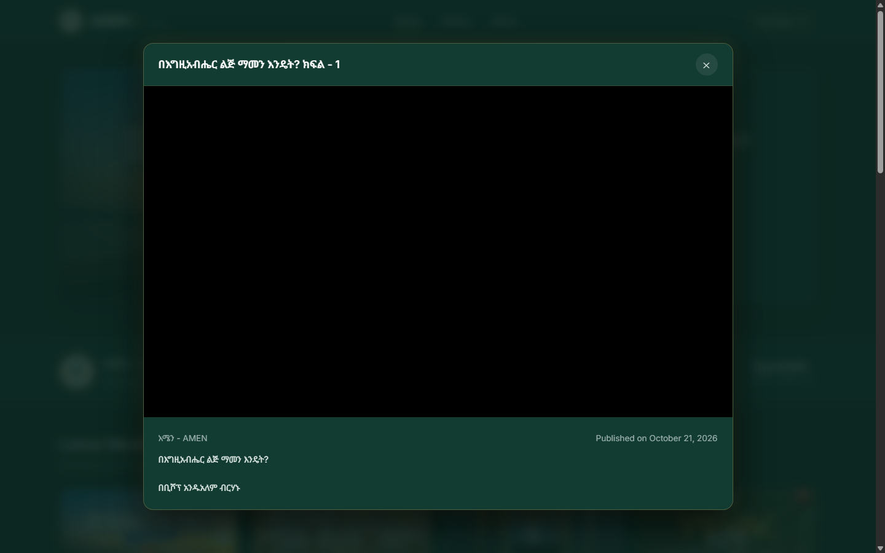
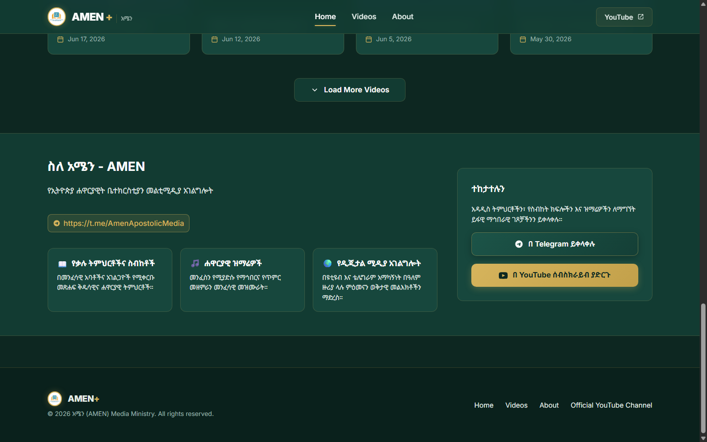
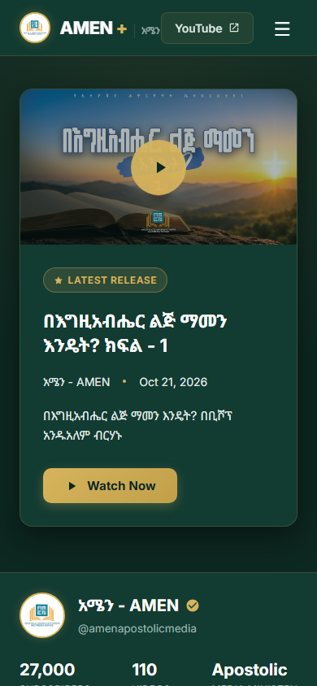
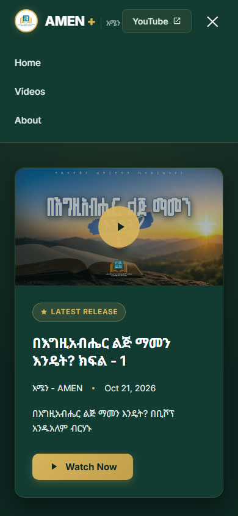
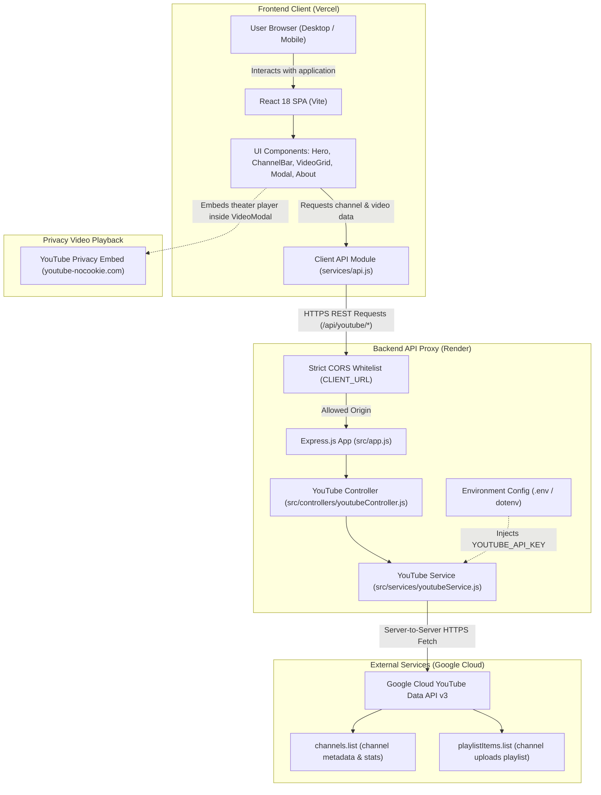

<div align="center">

  

  # AMEN+ (አሜን+)
  ### A Secure Christian Media Streaming Platform for አሜን (AMEN) Media Ministry

  [](https://react.dev/)
  [](https://vite.dev/)
  [](https://nodejs.org/)
  [](https://expressjs.com/)
  [](https://developers.google.com/youtube/v3)
  [](LICENSE)

  **[Live Website](https://amen-plus.vercel.app/)** • **[Official YouTube Channel](https://www.youtube.com/@amenapostolicmedia)** • **[Telegram](https://t.me/AmenApostolicMedia)**

</div>

---

## 📖 Project Overview

**AMEN+** is a dedicated Christian media streaming platform created for **አሜን - AMEN** (`@amenapostolicmedia`), an official media ministry of the **Apostolic Church of Ethiopia**. 

The ministry produces sermons, apostolic teachings, conference broadcasts, and gospel songs in Amharic. While YouTube serves as the underlying distribution channel, viewing media on YouTube exposes congregation members and seekers to intrusive commercial advertisements, irrelevant algorithmic recommendations, and potential external distractions.

AMEN+ solves this problem by delivering a curated, ad-free, theater-style streaming experience directly connected to the channel's media catalogue. Operating through a secure backend proxy built with Node.js and Express, AMEN+ communicates with the **YouTube Data API v3** to sync videos, channel metadata, and uploads dynamically while strictly isolating API credentials on the server.

---

## 📸 Screenshots Gallery

### Desktop Experience

| Homepage & Hero Spotlight | Video Browsing Section |
| :---: | :---: |
|  |  |

| Theater Video Player Modal | Ministry About & Community |
| :---: | :---: |
|  |  |

### Mobile Experience

| Mobile Homepage & Stream | Mobile Slide-down Navigation |
| :---: | :---: |
|  |  |

---

## ✨ Key Features

- **🔴 Dynamic YouTube Data Synchronization**: Automatically retrieves verified channel metadata, live statistics (27,000 subscribers, 110 videos, 2.6M+ channel views), and the uploads catalogue.
- **🎬 Featured Hero Spotlight**: Automatically highlights the channel's latest video release with quick-action playback and high-resolution thumbnail backdrops.
- **⚡ Progressive Pagination & Deduplication**: Fetches 20 media releases initially and appends 10 additional videos on each "Load More" click. Uses `Set`-based ID filtering to guarantee no duplicate videos appear in the feed.
- **📺 Privacy-Enhanced Modal Player**: Plays videos using YouTube's official privacy-enhanced embed domain (`youtube-nocookie.com`). Supports keyboard escape dismissal, backdrop click closing, and automatic focus management.
- **🎨 Custom Ethiopian Apostolic Aesthetic**: Styled with a tailored palette of Deep Emerald Green (`#123B32`, `#0D2721`) and Champagne Gold (`#D6B45C`), combined with `Inter` and `Noto Sans Ethiopic` typography.
- **♿ Implemented Accessibility Features**:
  - Full keyboard navigability on video cards (`Enter` and `Space` activation, visible focus outlines).
  - Modal focus-trapping preventing focus from escaping the modal dialog during playback.
  - Initial focus placement on modal launch and automatic focus restoration to the trigger element upon dismissal.
  - Semantic ARIA attributes including `role="dialog"`, `aria-modal="true"`, `aria-expanded`, `aria-controls`, and `aria-label`.
  - Decorative icons hidden from assistive technologies via `aria-hidden="true"`.
- **🔍 SEO & Social Sharing Optimization**: Complete Open Graph protocol and Twitter Card tags with dedicated 1200 × 630 px social sharing banner (`/og-banner.png`), canonical URL declaration, `/robots.txt`, and `/sitemap.xml`.
- **🛡️ Secure API Proxy**: Zero client-side API key exposure. Backend proxy enforces exact-origin CORS whitelisting, parameter validation, and automatic token redaction in server error responses.

---

## 🛠️ Technology Stack

| Layer | Technology | Purpose |
| :--- | :--- | :--- |
| **Frontend Framework** | React 18.3.1 | Component-based user interface and state management |
| **Build Tool** | Vite 6.2.0 | High-performance bundling and local development environment |
| **Styling** | Vanilla CSS3 (Design Tokens) | Custom CSS variables for Deep Emerald and Champagne Gold theme |
| **Typography** | Google Fonts | `Inter` (UI elements) and `Noto Sans Ethiopic` (Amharic text) |
| **Backend Runtime** | Node.js (>=18.0.0) | Asynchronous JavaScript runtime |
| **Backend Framework** | Express 4.21.2 | RESTful API proxy, routing, and middleware management |
| **Security & CORS** | `cors` 2.8.5, `dotenv` 16.4.7 | Exact-origin whitelisting and environment isolation |
| **External API** | YouTube Data API v3 | Google Cloud REST service for channel and playlist metadata |
| **Video Playback** | YouTube IFrame API (No-Cookie) | `youtube-nocookie.com` privacy-enhanced video embed |
| **Frontend Hosting** | Vercel | Global edge CDN deployment with automated CI/CD |
| **Backend Hosting** | Render | Cloud web service hosting for Express API proxy |

---

## 🏛️ System Architecture



---

## ⚙️ How the Application Works

1. **Initial Mount & Concurrent Fetching**: When a user accesses the platform, `App.jsx` initiates a concurrent `Promise.all` request to `fetchChannel()` and `fetchVideos({ maxResults: 20 })`.
2. **Backend Proxy Routing**: The request travels to the Express backend proxy. The `cors` middleware verifies that the incoming `Origin` matches an authorized frontend domain.
3. **Upstream Data Ingestion**: The backend `youtubeService` validates its local `YOUTUBE_API_KEY` and dispatches authenticated requests to Google's `channels` and `playlistItems` endpoints.
4. **Data Normalization & Error Redaction**: Raw YouTube responses are filtered to discard private or deleted videos. Any error messages returned from Google Cloud are stripped of API keys using a regex sanitizer before reaching the browser.
5. **UI Rendering**: The client populates the latest media item into the featured `Hero` spotlight, fills the `ChannelBar` with live metrics, and renders the 20 items in a responsive grid.
6. **On-Demand Pagination**: Clicking "Load More Videos" queries `/api/youtube/videos` with the stored `nextPageToken` and `maxResults: 10`. The new videos are merged into state while filtering against existing IDs.
7. **Accessible Playback**: Clicking any video thumbnail or the "Watch Now" action displays `VideoModal`, initiates focus trapping on the dialog, and renders the video via `youtube-nocookie.com`.

---

## 📁 Repository Structure

```
amen-plus/
├── client/                               # Frontend Single Page Application
│   ├── public/
│   │   ├── favicon.svg                   # Browser favicon
│   │   ├── icons.svg                     # SVG icon sprite
│   │   ├── logo.png                      # Official 800×800 genuine PNG brand logo
│   │   ├── og-banner.png                 # Official 1200×630 PNG social sharing banner
│   │   ├── robots.txt                    # Search engine crawler directives
│   │   └── sitemap.xml                   # XML sitemap for SEO discovery
│   ├── src/
│   │   ├── assets/                       # Static visual assets
│   │   ├── components/                   # Modular UI components
│   │   │   ├── AboutSection.jsx          # Ministry background, Telegram link & details
│   │   │   ├── ChannelBar.jsx            # Live subscriber count & verified badge
│   │   │   ├── Footer.jsx                # Copyright, ministry note & navigation links
│   │   │   ├── Header.jsx                # Navigation bar & mobile menu drawer
│   │   │   ├── Hero.jsx                  # Featured latest release spotlight
│   │   │   ├── VideoCard.jsx             # 16:9 thumbnail, metadata & keyboard actions
│   │   │   └── VideoModal.jsx            # YouTube iframe modal with focus trap
│   │   ├── services/
│   │   │   └── api.js                    # Fetch wrapper for backend API endpoints
│   │   ├── App.css                       # Layout helper styles
│   │   ├── App.jsx                       # Root application component & pagination state
│   │   ├── index.css                     # Emerald & Champagne Gold design tokens
│   │   └── main.jsx                      # React 18 DOM entry point
│   ├── index.html                        # HTML shell & Open Graph / Twitter metadata
│   └── vite.config.js                    # Vite bundler configuration
│
├── server/                               # Backend API Proxy Application
│   ├── src/
│   │   ├── config/
│   │   │   └── youtube.js                # Environment configuration loader
│   │   ├── controllers/
│   │   │   └── youtubeController.js      # Parameter validation & response dispatching
│   │   ├── routes/
│   │   │   └── youtubeRoutes.js          # REST routes definition
│   │   ├── services/
│   │   │   └── youtubeService.js         # YouTube API fetch logic & error sanitization
│   │   └── app.js                        # Express initialization, CORS & health route
│   ├── .env.example                      # Environment variables template
│   └── package.json                      # Backend dependencies & startup scripts
│
├── docs/
│   ├── screenshots/                      # Real production screenshots gallery
│   │   ├── desktop_homepage.png          # 1440×900 desktop homepage preview
│   │   ├── desktop_video_grid.png        # 1440×1000 video browsing preview
│   │   ├── desktop_player_modal.png      # 1440×900 video player modal preview
│   │   ├── desktop_about_section.png     # 1440×900 ministry about section preview
│   │   ├── mobile_homepage.png           # 390×844 mobile viewport preview
│   │   └── mobile_navigation.png         # 390×844 mobile navigation menu preview
│   └── PORTFOLIO.md                      # Software engineering portfolio summary
│
└── README.md                             # Comprehensive project documentation
```

---

## 📡 API Overview

All backend endpoints are served under `/api`:

| Method | Endpoint | Query Parameters | Description |
| :--- | :--- | :--- | :--- |
| `GET` | `/api/health` | None | Service heartbeat and uptime check |
| `GET` | `/api/youtube/channel` | None | Returns verified channel metadata, subscriber count, view count, and uploads playlist ID |
| `GET` | `/api/youtube/videos` | `maxResults` (1–50, default: 20)<br>`pageToken` (optional string) | Returns uploads playlist items, thumbnail URLs, published dates, and pagination tokens |

### Sample Response: `GET /api/youtube/channel`
```json
{
  "success": true,
  "data": {
    "id": "UC_CHANNEL_ID_REDACTED",
    "title": "አሜን - AMEN",
    "description": "የኢትዮጵያ ሐዋርያዊት ቤተክርስቲያን መልቲሚዲያ አገልግሎት\n\nhttps://t.me/AmenApostolicMedia\n",
    "customUrl": "@amenapostolicmedia",
    "statistics": {
      "viewCount": "2614803",
      "subscriberCount": "27000",
      "videoCount": "110"
    },
    "uploadsPlaylistId": "UU_PLAYLIST_ID_REDACTED"
  }
}
```

---

## 🔐 Environment Configuration

Create a `.env` file inside `server/` based on `server/.env.example`:

```ini
# Server Listening Port (automatically assigned by Render in production)
PORT=5000

# Allowed Frontend Origins (supports comma-separated origins)
CLIENT_URL=http://localhost:5173,https://your-frontend-domain.vercel.app

# Google Cloud YouTube Data API v3 Key
YOUTUBE_API_KEY=your_google_cloud_youtube_api_key_here

# Channel & Uploads Playlist Identifiers
YOUTUBE_CHANNEL_ID=your_youtube_channel_id_here
YOUTUBE_UPLOADS_PLAYLIST_ID=your_youtube_uploads_playlist_id_here
```

The frontend uses Vite environment variables (optional for local development, defaults to relative or localhost proxy):

```ini
# client/.env (Optional in production)
VITE_API_BASE_URL=https://<your-backend-api>.onrender.com/api
```

---

## 💻 Local Installation and Setup

### Prerequisites
- **Node.js** `v18.0.0` or higher
- **npm** `v9.0.0` or higher
- **Google Cloud YouTube Data API v3 Key** ([Google Cloud Console](https://console.cloud.google.com/apis/credentials))

### 1. Clone the Repository
```bash
git clone https://github.com/petersisay/AMEN-.git
cd amen-plus
```

### 2. Configure and Run Backend
```bash
cd server
npm install
cp .env.example .env
# Edit .env and supply your YOUTUBE_API_KEY
npm start
# Server listening on port 5000
```

Verify backend health:
```bash
curl http://localhost:5000/api/health
# {"status":"ok","message":"AMEN+ backend is running"}
```

### 3. Configure and Run Frontend
In a new terminal window:
```bash
cd client
npm install
npm run dev
# Vite dev server running at http://localhost:5173
```

Open your browser and navigate to `http://localhost:5173`.

---

## 🔒 Security Architecture

- **Server-Side Credential Isolation**: The Google Cloud `YOUTUBE_API_KEY` is loaded exclusively inside the Node.js process and never bundled into client JavaScript.
- **Strict Origin Whitelisting**: The Express server uses CORS origin matching against configured `CLIENT_URL` domains. Cross-origin requests from unauthorized origins do not receive permissive CORS headers.
- **Regex Error Sanitization**: If the YouTube Data API rejects a request or returns an error containing URL query parameters, a sanitization routine strips `key=[^&\s]+` and replaces it with `key=[REDACTED]` prior to dispatching responses.
- **Privacy-Enhanced Media Embedding**: Playback iframes point to `youtube-nocookie.com`, preventing YouTube from storing tracking cookies before playback begins.
- **Safe External Link Rel Attributes**: Outgoing links to Telegram and YouTube consistently declare `target="_blank"` and `rel="noopener noreferrer"` to protect against tab-nabbing vulnerabilities.

---

## 🧪 Testing & Verification

The project underwent extensive live production verification (Stage 5 and Stage 6 audits):
- **Live HTTP Health**: Verified HTTP 200 responses across root `/`, `/robots.txt`, `/sitemap.xml`, `/logo.png`, and `/og-banner.png`.
- **Keyboard & Assistive Accessibility**: Verified `tabIndex` focusability, `Enter`/`Space` activation on video cards, `Escape` key dialog dismissal, initial focus placement, and Tab focus-trapping inside the player modal.
- **Pagination & Deduplication Integrity**: Tested paginated fetch with sequential tokens; verified duplicate filtering logic with JavaScript `Set`.
- **Build Verification**: Verified production build (`vite build`) compiles cleanly without bundle warnings.

---

## 🔮 Future Improvements

1. **In-Memory Server Caching**: Implement in-memory TTL caching (15–30 minutes) on the Express proxy to reduce YouTube API quota consumption.
2. **Category & Topic Filtering**: Add client-side category pills (e.g., *Teachings*, *Sermons*, *Worship*) for instant content filtering.
3. **Keyword Search Bar**: Introduce an instant search input allowing visitors to search by Amharic or English keywords across titles and descriptions.
4. **Favorites / Watch Later**: Enable `localStorage`-persisted bookmarks for saving teachings across sessions.

---

## 👤 Author & Acknowledgments

- **Developer**: **Petros Sisay** — [GitHub](https://github.com/petersisay) • [LinkedIn](https://linkedin.com/in/petersisay)
- **Ministry**: [አሜን - AMEN (Apostolic Church of Ethiopia)](https://www.youtube.com/@amenapostolicmedia)
- **Telegram Channel**: [@AmenApostolicMedia](https://t.me/AmenApostolicMedia)
- **License**: This project is open-source under the [MIT License](LICENSE).
