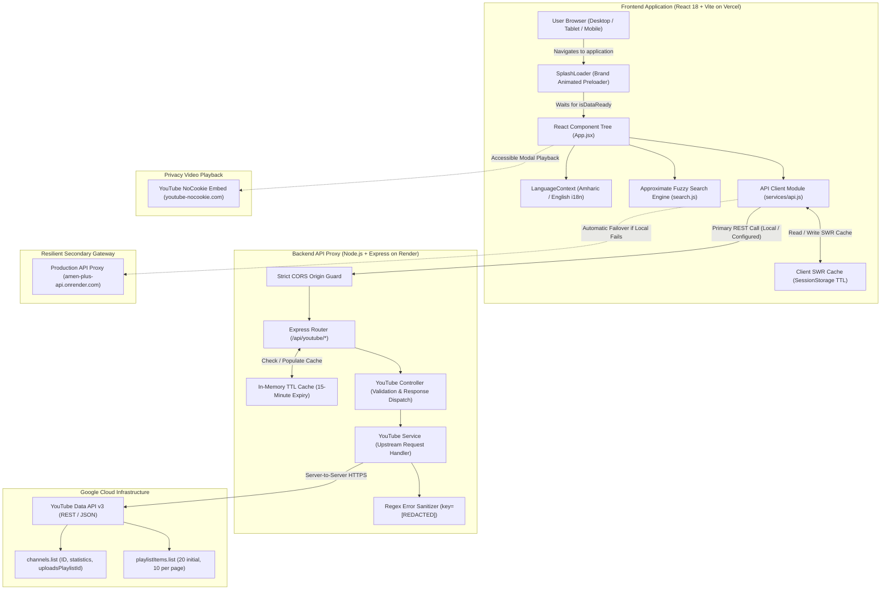
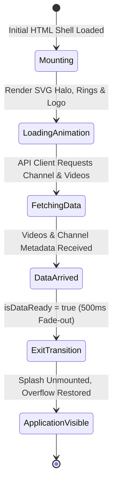

# AMEN+ System Architecture & Engineering Design

This document details the software architecture, data flow, caching mechanisms, security boundaries, and resilience strategies implemented across the **AMEN+ (አሜን+)** media streaming platform.

---

## 🏛️ High-Level System Architecture

AMEN+ operates on a decoupled multi-cloud architecture connecting a modern single-page React frontend hosted on Vercel's global edge network to a secure Node.js/Express API proxy hosted on Render.



---

## ⚡ Full-Stack Caching & Performance Engine

To deliver instantaneous load times and drastically reduce YouTube Data API quota consumption, AMEN+ incorporates a multi-tier caching strategy spanning client storage, HTTP headers, and server memory:

```
[User Request] 
      │
      ▼
┌──────────────────────────────────────────────┐
│ Tier 1: Client-Side SWR Cache (sessionStorage)│  ---> HIT: Returns data in <5ms
└──────────────────────────────────────────────┘
      │ MISS or EXPIRED (TTL > 15m)
      ▼
┌──────────────────────────────────────────────┐
│ Tier 2: HTTP Cache-Control Headers            │  ---> HIT: 304 Not Modified
└──────────────────────────────────────────────┘
      │ MISS / Network Roundtrip
      ▼
┌──────────────────────────────────────────────┐
│ Tier 3: Express In-Memory Server Cache        │  ---> HIT: Returns data in <20ms
└──────────────────────────────────────────────┘
      │ MISS or EXPIRED (TTL > 15m)
      ▼
┌──────────────────────────────────────────────┐
│ Tier 4: Google Cloud YouTube Data API v3      │  ---> Fetches upstream & repopulates tiers
└──────────────────────────────────────────────┘
```

### 1. Client-Side SWR (Stale-While-Revalidate) Cache
- **Location**: `client/src/services/api.js`
- **Storage Medium**: `window.sessionStorage`
- **TTL**: 15 minutes (`CACHE_TTL_MS = 15 * 60 * 1000`)
- **Key Partitioning**:
  - `amen_channel_data`: Channel metadata, subscriber count, total video count, and uploads playlist ID.
  - `amen_videos_cache_{maxResults}_{pageToken}`: Video batches indexed by page tokens and result limits.
- **Behavior**: On page reloads or tab navigation within the same session, cached payloads are returned immediately without incurring network latency.

### 2. Express Server In-Memory TTL Cache
- **Location**: `server/src/controllers/youtubeController.js`
- **Storage Medium**: Volatile Process Heap Memory (`Map`)
- **TTL**: 15 minutes (`CACHE_TTL = 15 * 60 * 1000`)
- **Features**:
  - Automatic expiration check on every access (`isExpired(entry)`).
  - Periodic background sweep every 30 minutes to prune stale entries and avoid memory leaks.
  - Emits `X-Cache: HIT` or `X-Cache: MISS` diagnostic headers.
  - Emits `Cache-Control: public, max-age=900, stale-while-revalidate=1800` headers for edge/browser intermediaries.

---

## 🛡️ Security Boundaries & Privacy Sandbox

### 1. Server-Side Credential Isolation
- Google Cloud API credentials (`YOUTUBE_API_KEY`) are stored strictly inside the backend environment (`server/.env`).
- Client builds generated by Vite contain **zero** references to YouTube API keys.
- Network inspection on the client reveals only requests to `/api/youtube/*`, preventing unauthorized quota exhaustion or key extraction.

### 2. Exact-Origin CORS Whitelisting
- Express server enforces strict CORS through the `cors` package:
  ```javascript
  const allowedOrigins = process.env.CLIENT_URL
    ? process.env.CLIENT_URL.split(',').map((origin) => origin.trim().replace(/\/$/, ''))
    : ['http://localhost:5173'];
  ```
- Any unauthorized origin attempting to consume the API receives a CORS error without permissive headers.

### 3. Regex Error Sanitization
- If upstream Google Cloud APIs return error messages containing URL strings with query parameters, the server sanitizes them before transmitting them to the client:
  ```javascript
  sanitizedMessage = rawMessage.replace(/key=[^&\s]+/gi, 'key=[REDACTED]');
  ```

### 4. Privacy-Enhanced Video Playback
- Video playback is isolated inside `VideoModal.jsx` using `https://www.youtube-nocookie.com/embed/{videoId}`.
- YouTube does not set tracking cookies on the user's device unless they explicitly press play.
- All outbound ministry links (Telegram, YouTube) declare `target="_blank"` with `rel="noopener noreferrer"`.

---

## 🔄 Dual-Layer Resilient API Fallback

In production or local development where local backend credentials might be unconfigured or network-blocked, the client API module (`client/src/services/api.js`) employs an automatic fallback:

1. **Primary Request**: Dispatched to the configured backend (`http://localhost:5000/api` or `VITE_API_BASE_URL`).
2. **Failure Detection**: If the primary endpoint returns an HTTP error (e.g., 500, 400, or network offline), the client catches the rejection.
3. **Transparent Fallback**: The client automatically retries the identical request against the production backup gateway (`https://amen-plus-api.onrender.com/api`).
4. **Zero UI Disruption**: The user experiences no interrupted states or breaking errors as long as either gateway responds.

---

## 🎬 Brand-Animated Splash Preloader State Machine

To prevent unstyled layout shifts and ensure video feeds are ready before presentation, AMEN+ employs a brand-animated preloader (`client/src/components/SplashLoader.jsx`):



- **Critical CSS Pre-linking**: `<link rel="stylesheet" href="/src/index.css">` in `index.html` prevents Flash of Unstyled Content (FOUC).
- **Strict Data Gating**: The preloader will not transition out until `channel` and `videos` (`videos.length > 0`) are confirmed in React state.
- **Graceful Error Recovery**: If all API gateways fail, an intuitive retry button and error alert allow users to retrigger the request without getting trapped.
